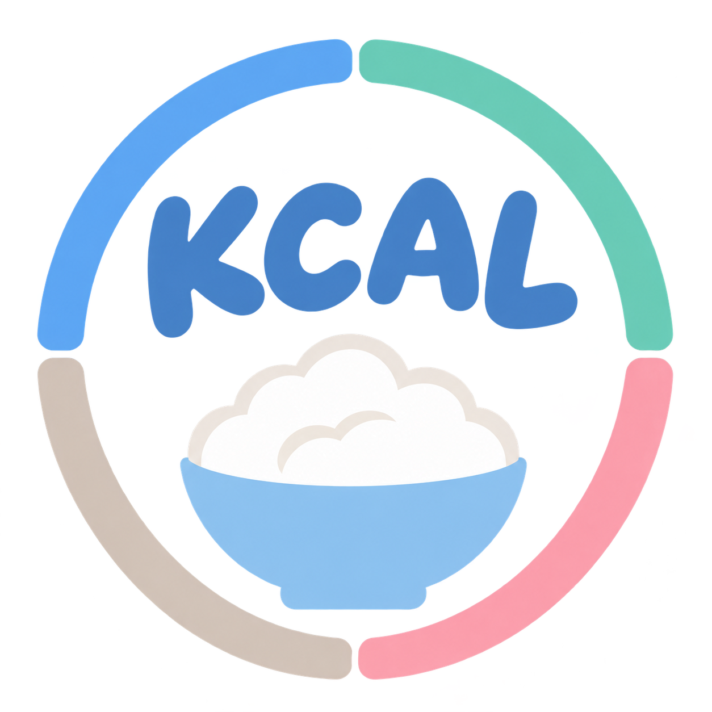
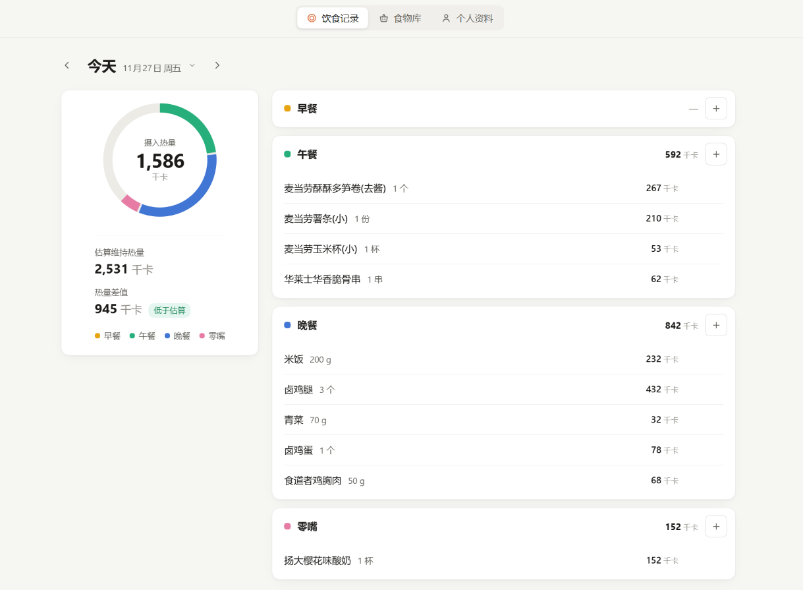

<p align="center">
  
</p>

<h1 align="center">DSH 卡路里记录</h1>

<p align="center">DeepSeek Harness 插件，用来记录每天吃了什么、摄入了多少热量。</p>

<p align="center">
  <a href="#快速开始">快速开始</a> ·
  <a href="#功能">功能</a> ·
  <a href="#备份与恢复">备份与恢复</a> ·
  <a href="#开发">开发</a>
</p>


## 功能

- **饮食记录**：按早餐、午餐、晚餐、零嘴记录每天吃的东西，自动算出每餐和全天的热量。
- **食物库**：保存常吃的食物及其营养资料，可以设置「1 碗 = 150 g」这样的份量换算。
- **个人资料**：填写出生日期、性别、身高、体重和日常活动等级后，会估算每天的维持热量，并显示与摄入热量的差值。
- **和 AI 对话记录**：在 DSH 里直接告诉 AI 你吃了什么，它会帮你查找食物并记下来。



## 快速开始

**安装方式一 (DSH 内安装)：**

打开「插件」→「添加插件」，输入 `dsh-calorie-helper`，点击「安装」，再点击「立即启用」。启用后，从侧边栏打开「卡路里记录」。

**安装方式二 (命令行安装):**

执行下列命令，然后重启 `dsh web`。

```powershell
dsh plugin --profile web add dsh-calorie-helper
```


**发送下面的提示词试试吧:**

```prompt
我今天吃了麦当劳的酥酥多笋卷和小薯条，玉米杯
```


## 数据在哪里

所有数据保存在 `DSH_HOME/storages/calorie-helper/calorie.sqlite`。没有设置 `DSH_HOME` 时，它是用户目录下的 `.dsh`。

## 备份与恢复

**备份**可以在 DSH 运行时进行：

```powershell
node scripts/data.mjs backup
```

命令会打印备份文件的路径，文件保存在数据目录下的 `backups/` 里。换电脑时带上这一个文件就够了。

**恢复**要先退出 DSH：

```powershell
node scripts/data.mjs restore 'D:\备份\calorie-xxxx.sqlite'
```

如果数据目录里已经有数据，恢复会拒绝覆盖。确实要覆盖时，先把 `calorie.sqlite`、`calorie.sqlite-wal`、`calorie.sqlite-shm` 移到别处保存，再执行恢复。

`scripts/data.mjs` 也随安装包附带，需要 Node.js 24.9 或更新版本。

## 开发

```powershell
pnpm install
pnpm typecheck
pnpm test
pnpm pack --pack-destination dist
```

打包结果在 `dist/` 下。

## 发布

PR 和推送到 `main` 会运行检查，成功后可在 GitHub Actions 的运行页面下载 `.tgz`。

首次自动发布前，在 npm 包的设置中添加 GitHub Actions Trusted Publisher。所有者填写 `Laucky67`，仓库填写 `DSH-CalorieHelper`，工作流文件名填写 `release.yml`，允许 `npm publish`。

更新版本并提交后，推送与版本号一致的标签，例如 `v0.2.4`。发布工作流会先用 DSH Web 安装并验证安装包，然后将同一个 `.tgz` 发布到 npm 并附到 GitHub Release。
